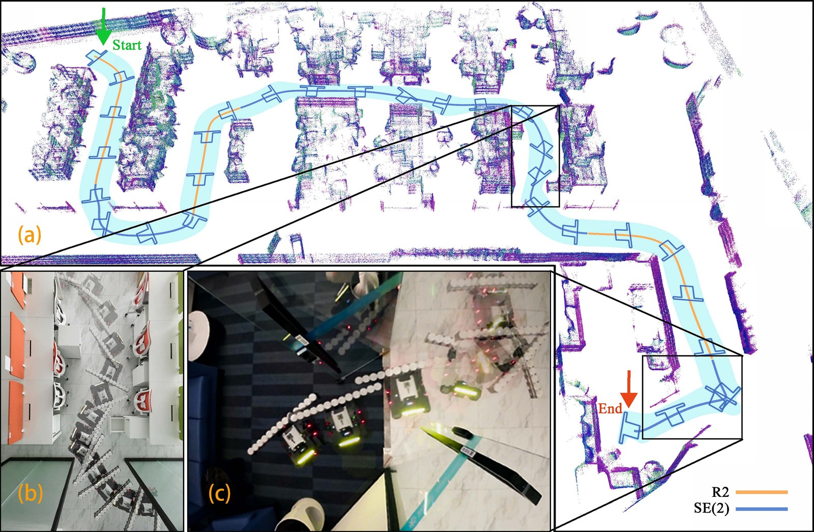
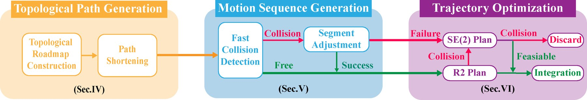
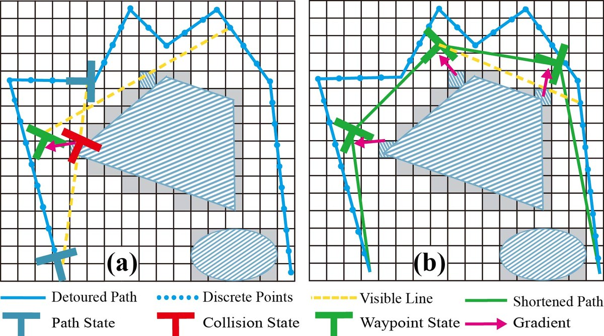
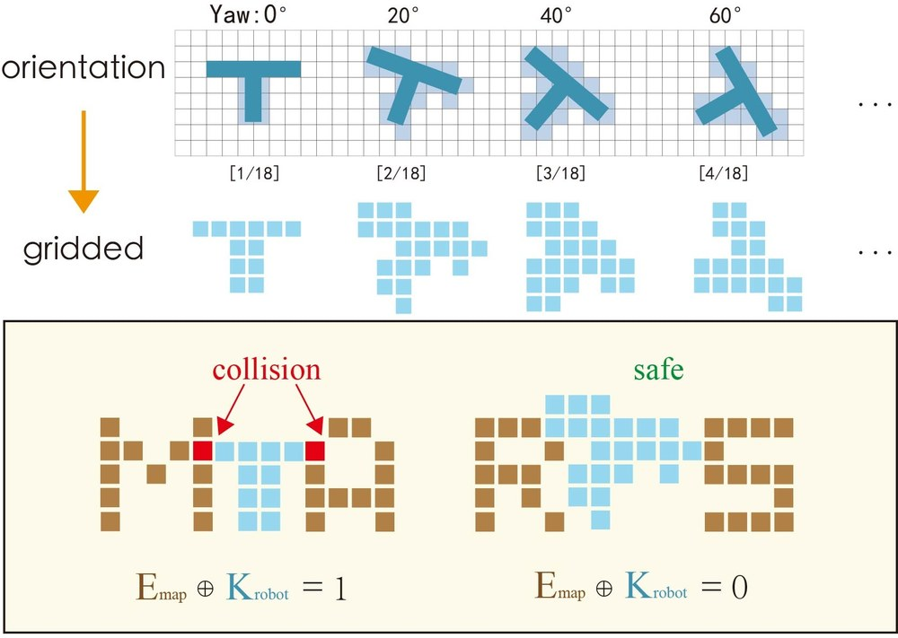
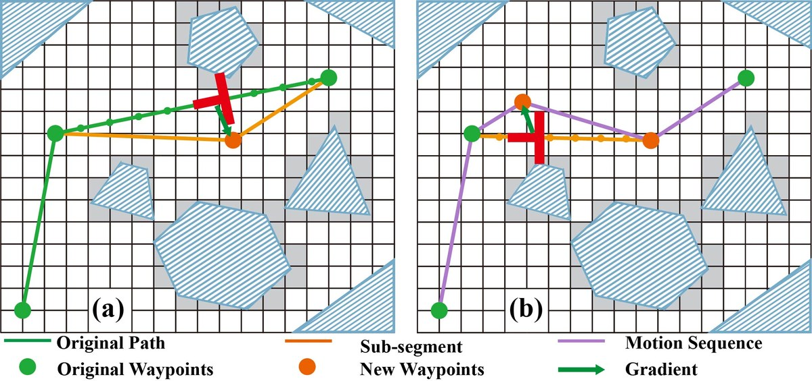
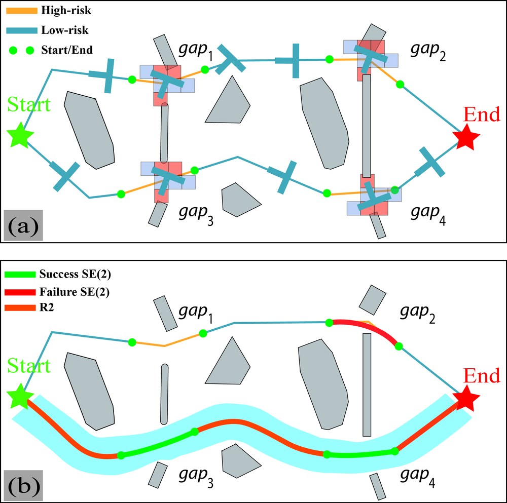
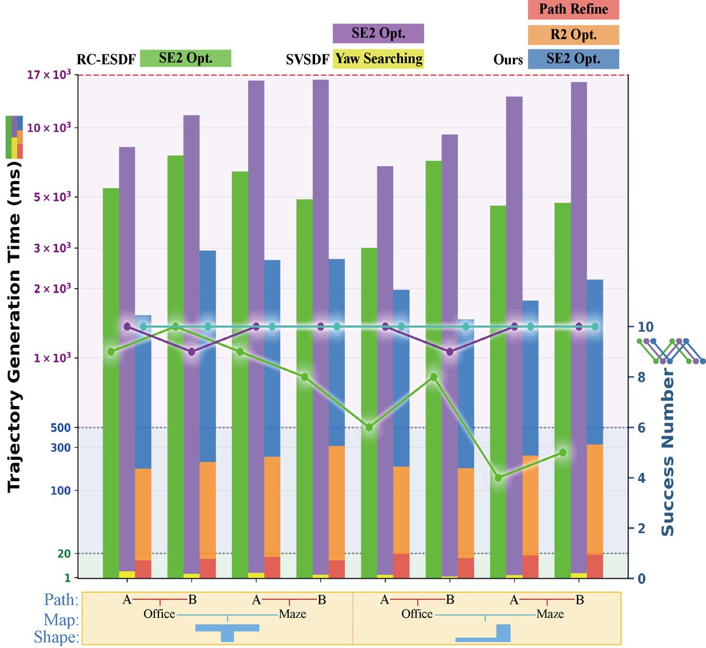

<div align="center">
    <h2>ESV-Planner: Efficient Swept Volume-Based Trajectory Generation for Arbitrary-Shaped Ground Robot Navigation</h2>
    <strong>IROS 2025</strong>
    <br>
        <a href="https://www.linkedin.com/in/yisheng-li-454494140/?locale=en" target="_blank">Yisheng Li</a>*,
        <a href="https://github.com/YLJ6038" target="_blank">Longji Yin</a>*,
        <a href="https://github.com/Ecstasy-EC" target="_blank">Yixi Cai</a>,
        <a href="https://jianhengliu.github.io/" target="_blank">Jianheng Liu</a>,
        <a href="https://github.com/zfc-zfc" target="_blank">Fangcheng Zhu</a>,
        <a href="https://www.linkedin.com/in/mingpu-ma/" target="_blank">Mingpu Ma</a>,
        <a href="https://github.com/stdcat" target="_blank">Siqi Liang</a>,
        <a href="https://scholar.google.com/citations?user=HEiv7-AAAAAJ&hl=zh-CN" target="_blank">Haotian Li</a>, and
        <a href="https://mars.hku.hk/people.html" target="_blank">Fu Zhang</a>
    <br>
    <sub>* Equal contribution</sub>
    <p>
        <h5>HKU MaRS Lab</h5>
    </p>
    <a href="https://arxiv.org/abs/2504.07554"></a>
    <a href="https://doi.org/10.1109/IROS60139.2025.11247085"></a>
    <a href="#video-demo"></a>
</div>

<p align="center">
    
    <br>
    <em>(a) A trajectory planned through an office map: R2 segments in orange, SE(2) segments in blue. (b), (c) Real-world experiments.</em>
</p>

## Updates

* **Oct. 2026** - Code released, with three demos: an L-shaped, a T-shaped and a rectangular robot.
* **2025** - Our paper was accepted by [IEEE/RSJ IROS 2025](https://doi.org/10.1109/IROS60139.2025.11247085).

If our repository supports your academic projects, please cite our paper. Thank you!

```bibtex
@inproceedings{li2025efficient,
    title={Efficient Swept Volume-Based Trajectory Generation for Arbitrary-Shaped Ground Robot Navigation},
    author={Li, Yisheng and Yin, Longji and Cai, Yixi and Liu, Jianheng and Zhu, Fangcheng and Ma, Mingpu and Liang, Siqi and Li, Haotian and Zhang, Fu},
    booktitle={2025 IEEE/RSJ International Conference on Intelligent Robots and Systems (IROS)},
    year={2025},
    doi={10.1109/IROS60139.2025.11247085}
}
```

## Video Demo

https://github.com/user-attachments/assets/9411e06e-1468-4921-9327-548d1de9693e

## Overview

Navigating an arbitrary-shaped ground robot safely in cluttered environments remains a challenging problem. Existing trajectory planners that account for the robot's physical geometry suffer from intractable runtime. To achieve both computational efficiency and Continuous Collision Avoidance (CCA), we propose a coarse-to-fine navigation framework:

1. **Topological paths.** A sampling-based method generates distinct topological paths that guarantee a minimum inflated margin.
2. **Geometry-aware front end.** The paths are discretized into full-state SE(2) robot motion sequences, using the robot's footprint precomputed at discrete yaw angles. Path points in collision are pushed away from obstacles while keeping the path's topology.
3. **SVSDF-based back end.** Each candidate is optimized as an R2 trajectory, and the pieces that still collide are re-optimized in SE(2) against the swept-volume signed distance field (SVSDF). The result is spliced into one continuous trajectory and validated against the swept volume.

<p align="center">
    
</p>

<table>
  <tr>
    <td align="center" width="50%"><br><em>Topological path shortening: a colliding state on the visible line is pushed away along the gradient.</em></td>
    <td align="center" width="50%"><br><em>Fast collision detection: the footprint is pre-gridded at discrete yaw angles and checked against the map with bitwise operations.</em></td>
  </tr>
  <tr>
    <td align="center"><br><em>Segment adjustment: a new waypoint, pushed along the gradient, turns a colliding segment into a collision-free motion sequence.</em></td>
    <td align="center"><br><em>Trajectory optimization: (a) high-risk segments around narrow gaps; (b) R2 and SE(2) sub-problems spliced into the final trajectory.</em></td>
  </tr>
</table>

Benchmarks show the method is one to several orders of magnitude faster than state-of-the-art methods in runtime, while keeping a high planning success rate and ensuring CCA.

<p align="center">
    
    <br>
    <em>Trajectory generation time (bars, log scale) and number of successes (lines) compared with RC-ESDF and SVSDF, for two robot shapes in office and maze maps.</em>
</p>

## Build Instructions

Tested on Ubuntu 20.04 with ROS Noetic, GCC 9.4.0 and Eigen 3.3.7 (x86-64).

```bash
# ROS Noetic (desktop-full) is assumed to be installed.
# The prebuilt LMBM solver needs the Fortran runtime:
sudo apt-get install libgfortran5

mkdir -p ~/esv_ws/src && cd ~/esv_ws/src
git clone https://github.com/hku-mars/ESV-Planner.git
cd ~/esv_ws
# run "sudo rosdep init && rosdep update" first if you have never used rosdep
rosdep install --from-paths src --ignore-src -y --rosdistro noetic
catkin_make -DCMAKE_BUILD_TYPE=Release
```

**Known build issues**

- The repository ships prebuilt **x86-64** libraries: libigl in [`lib/`](./lib) and the LMBM solver in [`utils/include/utils/lmbm.so`](./src/utils/include/utils/lmbm.so). ARM platforms (e.g. Jetson) are not supported yet.
- Build with `catkin_make`. `catkin build` (catkin_tools) has not been tested.
- `error while loading shared libraries: libgfortran.so.5` when starting `demo_node`: install `libgfortran5` as shown above.

**Report issue**

When reporting a build issue, please include the output of:

```bash
lsb_release -ds; uname -m; gcc --version | head -1; dpkg -s libeigen3-dev | grep Version
```

## Run the Demos

```bash
cd ~/esv_ws && source devel/setup.bash
roslaunch grid_path_searcher demo1.launch
```

RViz opens with the map. Press `G` (2D Nav Goal) and click on the map to set a goal; the robot starts at the launch file's start pose. Goals sent before the map has been loaded are ignored, and the planner logs `Global map is not ready yet`.

| Launch file | Map | Robot shape | Start pose |
| --- | --- | --- | --- |
| `demo1.launch` | [`map1.pcd`](./src/pcd_reader/pcd_release/map1.pcd) | L-shaped, [`sdLShape_new.obj`](./src/grid_path_searcher/shapes/sdLShape_new.obj) | (2.0, 0.1) |
| `demo2.launch` | [`map2.pcd`](./src/pcd_reader/pcd_release/map2.pcd) | T-shaped, [`sdTShape_new.obj`](./src/grid_path_searcher/shapes/sdTShape_new.obj) | (5.0, 0.1) |
| `demo3.launch` | [`map3.pcd`](./src/pcd_reader/pcd_release/map3.pcd) | 1.0 m × 0.3 m rectangle, [`sdDemo.obj`](./src/grid_path_searcher/shapes/sdDemo.obj) | (0.1, 0.1) |

<!-- TODO: add one GIF per demo, e.g.  -->

**Launch arguments**

| Argument | Default | Description |
| --- | --- | --- |
| `start_x`, `start_y` | per demo | Start position of the robot (m). |
| `rviz` | `true` | Open RViz with [`demo.rviz`](./src/grid_path_searcher/launch/rviz_config/demo.rviz). |
| `foxglove` | `false` | Also start [foxglove_bridge](https://github.com/foxglove/ros-foxglove-bridge) on port 8765, listening on all network interfaces. Requires `sudo apt-get install ros-noetic-foxglove-bridge`. |

```bash
roslaunch grid_path_searcher demo1.launch start_x:=7.0 start_y:=3.0
roslaunch grid_path_searcher demo2.launch rviz:=false foxglove:=true
```

**What RViz shows**

- **Map**: the point cloud (`Global_map`) and the occupancy grid (`Grid_map`).
- **Front_end**: the topological paths (`Topo_original_path`), the path checked with the robot footprint (`fast_check`, `fast_check_path`), and the footprint kernel (`roboKernelShape`).
- **Back_end**: the SE(2) optimizer's intermediate trajectory (`step_trajectory`).
- **vehicle_animation**: the robot moving along the final trajectory.
- **R2_traj** / **SE2_traj**: the final trajectory, split into R2 pieces and SE(2)-optimized pieces.

Detailed planner logs are written to `grid_path_searcher/debug.txt` instead of the terminal.

## Use Your Own Robot Shape

1. Put a closed triangle mesh of the robot in [`grid_path_searcher/shapes/`](./src/grid_path_searcher/shapes): the 2D footprint extruded into a thin slab centred on z = 0 (the SDF is evaluated in that plane), in the robot frame with the origin at the rotation centre and x pointing forward.
2. Point `inputdata` in the demo's config file (e.g. [`config/demo1.yaml`](./src/grid_path_searcher/config/demo1.yaml)) to it:

   ```yaml
   inputdata: "shapes/my_robot.obj"
   ```

   Any file name works: its signed distance field is computed from the mesh with libigl. The names `sdLShape`, `sdTShape`, `star` and `sdDemo` select built-in shape classes instead.
3. Make sure the footprint kernel covers the robot: it is a square of `kernel_size × occupancy_resolution` metres centred on the robot origin (21 × 0.1 m = 2.1 m by default). Parts of the robot outside it are ignored by the front end.

Keep `poly_params` at `[0.0, 0.0, 0.0]` and model the robot in its own frame instead.

## Use Your Own Map

Maps are loaded from PCD files by `pcd_reader`. Set `pcd_path` in the demo's [`pcd_reader/launch/demoN.launch`](./src/pcd_reader/launch/demo1.launch):

```xml
<param name="pcd_path" type="string" value="$(find pcd_reader)/pcd_release/my_map.pcd" />
<param name="globalPCFilterThresLower" type="double" value="0.0" />
<param name="globalPCFilterThresUpper" type="double" value="0.5" />
```

- The PCD must have the fields `x y z intensity`. Points with intensity below 6 are dropped (`intensity_thresh` in [`pcd_reader_node.cpp`](./src/pcd_reader/src/pcd_reader_node.cpp)).
- Only points with `globalPCFilterThresLower < z < globalPCFilterThresUpper` are kept as obstacles.
- The occupancy grid is centred on the origin and spans `mapSize_x × mapSize_y` metres at `occupancy_resolution`. Choose a start pose in free space.

## Parameters

Each demo loads its parameters from [`grid_path_searcher/config/demoN.yaml`](./src/grid_path_searcher/config). The defaults below are from `demo1.yaml`. `demo2.yaml` differs only in `inputdata`, `weight_pr` (10.0) and the sampling width (14.0 × 1.0 m); `demo3.yaml` differs only in `inputdata`.

**Robot and front end**

| Parameter | Default | Description |
| --- | --- | --- |
| `inputdata` | `shapes/sdLShape_new.obj` | Robot shape, see [Use Your Own Robot Shape](#use-your-own-robot-shape). |
| `occupancy_resolution` | 0.1 | Grid resolution (m). |
| `kernel_size` | 21 | Side of the footprint kernel in cells; must be odd. |
| `kernel_yaw_num` | 20 | Number of discrete yaw angles of the footprint; must be even. |
| `front_end_safeh` | 0.0 | Inflation of the footprint kernel (m); at least half a cell is always used. |
| `push_extra_dist` | 0.4 | Extra distance (m) a colliding path point is pushed beyond the first collision-free position, when the surroundings allow it. |
| `mapSize_x`, `mapSize_y` | 200, 200 | Size of the occupancy grid (m), centred on the origin. |

**Topological path search**

| Parameter | Default | Description |
| --- | --- | --- |
| `topo_prm_sample_width_x`, `_y` | 10.0, 10.0 | Size (m) of the sampling rectangle centred between start and goal; always widened to contain both. 0 uses the margins below. |
| `topo_prm_sample_margin_x`, `_y` | 4.0, 4.0 | Margins (m) added around the start/goal box when the width is 0. |
| `topo_prm_max_sample_num` | 20000 | Sampling stops at this many samples... |
| `topo_prm_max_sample_time` | 3.0 | ...or after this many seconds, whichever comes first. |
| `topo_prm_max_raw_path2` | 3 | Maximum number of raw topological paths. |
| `topo_prm_reserve_num` | 6 | Maximum number of candidate paths, shortest first. |
| `topo_prm_ratio_to_short` | 6.0 | Candidates longer than this times the shortest one are dropped. |

**R2 trajectory optimization**

| Parameter | Default | Description |
| --- | --- | --- |
| `rho_mid_end` | 2 | Weight of the trajectory duration. |
| `weight_pr` | 20.0 | Penalty for deviating from the front-end waypoints. |
| `vmax`, `omgmax` | 10, 10 | Velocity and angular-speed limits. |

**SE(2) SVSDF optimization**

| Parameter | Default | Description |
| --- | --- | --- |
| `rho` | 1.0 | Weight of the trajectory duration. |
| `weight_p` | 100.0 | Weight of the swept-volume collision penalty. |
| `safety_hor` | 0.1 | Clearance (m) the collision penalty aims for. |
| `se2_past`, `se2_delta_past` | 10, 0.1 | LMBM stops when the cost changes by less than `se2_delta_past` over `se2_past` iterations. |
| `se2_max_iter` | 150 | Iteration cap per optimization. |
| `se2_max_time` | 3.0 | Time budget per optimization (s). |
| `se2_stuck_window`, `se2_stuck_violation`, `se2_stuck_rel_tol` | 20, 0.01, 0.01 | Stop early when the trajectory still intrudes more than `se2_stuck_violation` m (summed) into the `safety_hor` band and this fell by less than `se2_stuck_rel_tol` over `se2_stuck_window` iterations. |
| `safety_hor_fastCheck` | 0.05 | Clearance (m) required by the final swept-volume safety check. Every result is checked, so early stopping never accepts an unsafe trajectory. |
| `threads_num` | 30 | OpenMP threads for the swept-volume evaluation. |
| `enableearlyExit`, `debugpause` | true, 1 | Draw every optimizer iteration in RViz, pausing `debugpause` ms. Set `enableearlyExit: false` for the fastest planning. |

## Code Structure

All packages are in [`src`](./src).

| Package | Contents |
| --- | --- |
| `grid_path_searcher` | Demo node, launch files, configs and robot shapes. |
| `planner_algorithm` | Topological path search (`topo_path_search`), R2 optimizer (`mid_end`) and SE(2) SVSDF optimizer (`back_end_optimizer`). |
| `fast_svsdf` | Planner pipeline (`planner_manager`) and the geometry-aware front end (`planner_strategy`). |
| `swept_volume` | Swept-volume SDF evaluation and footprint-kernel collision checks. |
| `map_manager` | Occupancy grid built from the global point cloud. |
| `pcd_reader` | Loads a PCD map and publishes it on `/globalmap`. |
| `utils` | Robot shapes, configuration, MINCO trajectories, optimizers and the bundled libigl headers. |
| `waypoint_generator` | Turns RViz goals into planner waypoints. |
| `visualization_pkg`, `common/traj_utils` | Visualization and trajectory messages. |

## Acknowledgements

Special thanks to [ZJU-FAST-Lab](https://github.com/ZJU-FAST-Lab) and [HKUST Aerial Robotics Group](https://github.com/HKUST-Aerial-Robotics) for their great works.

- The swept-volume SDF, map manager and LMBM interface are adapted from [Implicit-SVSDF-Planner](https://github.com/ZJU-FAST-Lab/Implicit-SVSDF-Planner).
- The MINCO trajectory class and numerical utilities come from [GCOPTER](https://github.com/ZJU-FAST-Lab/GCOPTER).
- The topological path search and path shortcutting are based on [Fast-Planner](https://github.com/HKUST-Aerial-Robotics/Fast-Planner).
- The SE(2) optimizer uses the [LMBM](https://napsu.karmitsa.fi/lmbm/) solver by Napsu Karmitsa.
- Geometry processing uses [libigl](https://github.com/libigl/libigl).

Third-party code keeps its original license.
